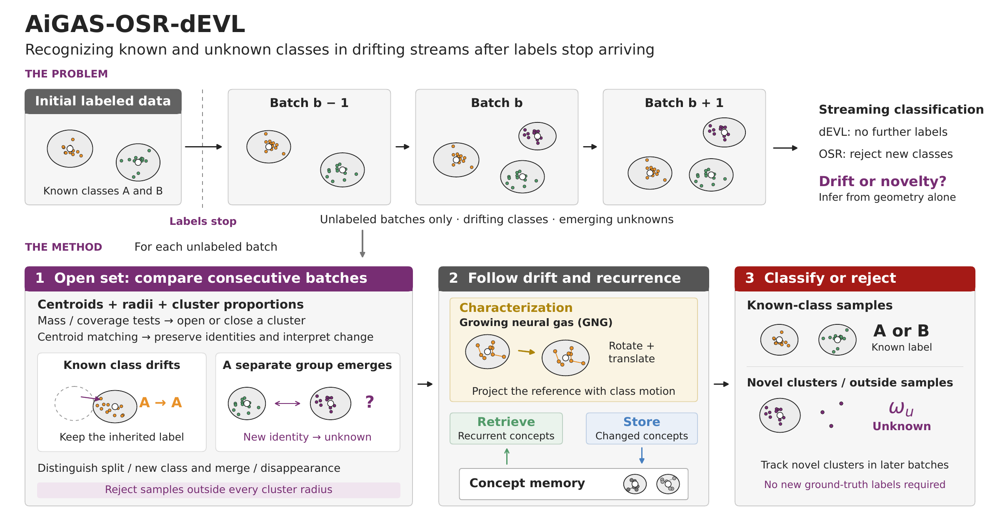

# AiGAS-OSR-dEVL: Incremental Open Set Recognition in Non-stationary Data Streams under Extreme Verification Latency

<p align="center">
  <a href="AiGAS_graphical_abstract.pdf" title="Graphical abstract (PDF)">
    
  </a>
</p>

Companion software for the paper: MINAS, KNNENS, and SENCForest baselines on LETTER and PENDIGITS, and on sixteen EVL prequential streams (`data/osr_dynamic/*.txt`, label column `CLASS`).

Committed outputs under `results/` are markdown tables. Benchmark drivers write temporary checkpoints outside `results/` unless you redirect them.

---

## Authors

**Maria Arostegi** · [ORCID 0000-0001-6691-4276](https://orcid.org/0000-0001-6691-4276)  
TECNALIA, Basque Research and Technology Alliance (BRTA), 48160 Derio, Spain

**Miren Nekane Bilbao** · [ORCID 0000-0002-0519-8728](https://orcid.org/0000-0002-0519-8728)  
University of the Basque Country (EHU), 48940 Leioa, Spain

**Javier Del Ser** · [ORCID 0000-0002-1260-9775](https://orcid.org/0000-0002-1260-9775) · *Corresponding author* · [javier.delser@tecnalia.com](mailto:javier.delser@tecnalia.com)  
TECNALIA, BRTA, Derio, Spain · University of the Basque Country (EHU), Leioa, Spain

---

## Abstract

In many practical applications, batches of data arrive as a stream whose classes can drift over time. Labels are often given only during a short initial period, whereas new classes, such as unseen fault patterns in industrial machinery or new types of attacks in network security, can appear at any later time. A model that forces such samples into a known class gives a confident wrong answer instead of raising an alert. Open Set Recognition (OSR) methods assume stationary data, whereas stream learners for extreme verification latency assume that no new classes appear in the stream. Without label verification, a known class that has moved as a result of the drift and a new emerging class can look alike. In this context we present the Adaptive Incremental neural GAS model for Open Set Recognition in drifting data streams under Extreme Verification Latency (AiGAS-OSR-dEVL). The model extends our earlier AiGAS-dEVL-RC with an open set stage. On each unlabeled batch, this stage compares the clusters of the current batch with those of the previous one, decides whether a cluster has appeared, split, merged or vanished, and rejects the samples that fall outside every cluster. On sixteen synthetic drifting streams, AiGAS-OSR-dEVL achieves the highest stream F1 score on each of the fourteen streams in which a new class emerges, against fifteen OSR, novelty detection and stream learning methods, and over all sixteen streams both the Wilcoxon signed rank test and a Bayesian signed rank analysis separate it from every competitor. On static OSR benchmarks, a simplified variant ranks unknown samples at least as well as the best baselines in three of four open settings, and it explains each rejection through per-feature contributions computed from the node distances that form its score, without a surrogate model. Overall, these results show that the geometry of unlabeled data alone can separate drift from novelty, so a stream classifier can keep labeling known classes and flag new ones long after the last label has arrived. Code available at: [https://github.com/javierdelser/AiGAS-OSR-dEVL](https://github.com/javierdelser/AiGAS-OSR-dEVL).

---

| | |
|---|---|
| **Journal** | *Applied Soft Computing* (submitted) |
| **Tables** | [docs/BENCHMARK_REPORT.md](docs/BENCHMARK_REPORT.md) |
| **Repository** | [github.com/javierdelser/AiGAS-OSR-dEVL](https://github.com/javierdelser/AiGAS-OSR-dEVL) |

---

## Benchmarks

| Benchmark | Data | Command | Output |
|-----------|------|---------|--------|
| Static (Letter / Pendigits) | `data/osr_static/` | `bash launch.sh static --cpus 8` | `results/osr_static/STREAM_BASELINES.md` |
| Dynamic (16 EVL streams) | `data/osr_dynamic/*.txt` | `bash launch.sh dynamic` | `results/osr_dynamic/SYNTHETIC_STREAM_TABLE.md` |

| Driver (direct) | |
|-----------------|---|
| Static | `python scripts/osr_static/run_benchmark.py --cpus 8` |
| Dynamic | `python scripts/osr_dynamic/run_benchmark.py` |

**Requirements:** Linux, Python 3.12. First time: `bash launch.sh setup`.

---

## Quick start

```bash
bash launch.sh setup
bash launch.sh static --cpus 8
bash launch.sh dynamic
```

---

## AiGAS-OSR-dEVL (proposed method)

| Protocol | Code | Command |
|----------|------|---------|
| Static GNG + open-set rescoring | `src/aigas_osr_devl/static/`, `src/osr_static/improvements.py`, `gng_mahalanobis.py`, `gng_variants.py`, `explain.py` | `AIGAS_PHASE1_DIR=…/phase1/raw/phase1 bash launch.sh aigas-static` |
| Stream GNG + cardinality tracker | `legacy/aigas_osr_devl/` (`Aigas_OSR_Open.py`, `ClassTracker`) | `bash launch.sh aigas-dynamic` (NeuPy: set `AIGAS_PYTHON` or use `garage/bin/python`) |

Import: `from aigas_osr_devl.stream import ClassTracker` (alias `RastreadorClases`).

---

## Layout

```
├── data/osr_static/               LETTER & PENDIGITS + partitions
├── data/osr_dynamic/              EVL stream CSVs (*.txt)
├── legacy/aigas_osr_devl/         stream AiGAS driver (NeuPy)
├── legacy/osr_GNG_Train_*.py       Phase-1 GNG training
├── src/osr_static/                baselines + rescoring
├── AiGAS_graphical_abstract.pdf
├── docs/graphical_abstract.png
├── src/aigas_osr_devl/            static rules + stream wrapper
├── scripts/osr_*/run_benchmark.py
├── scripts/osr_*/run_aigas_benchmark.py
├── results/
└── launch.sh
```

---

## Cite this work

BibTeX key: `aigas_osr_devl_2026`.

```bibtex
@article{aigas_osr_devl_2026,
  title   = {AiGAS-OSR-dEVL: Incremental Open Set Recognition in Non-stationary Data Streams under Extreme Verification Latency},
  author  = {Arostegi, Mar{\'i}a and Bilbao, Miren Nekane and {Del Ser}, Javier},
  journal = {Applied Soft Computing},
  year    = {2026},
  note    = {Submitted. Code: \url{https://github.com/javierdelser/AiGAS-OSR-dEVL}},
  url     = {https://github.com/javierdelser/AiGAS-OSR-dEVL}
}
```

---

## Checksums

After changing tracked files:

```bash
find . -type f ! -path './MANIFEST.sha256' ! -path './.git/*' -print0 | sort -z | xargs -0 sha256sum > MANIFEST.sha256
```